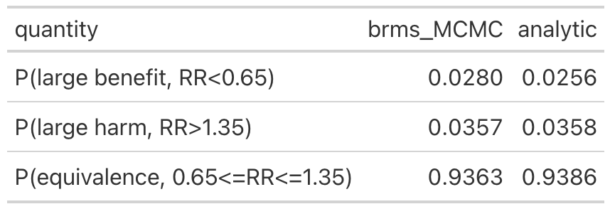
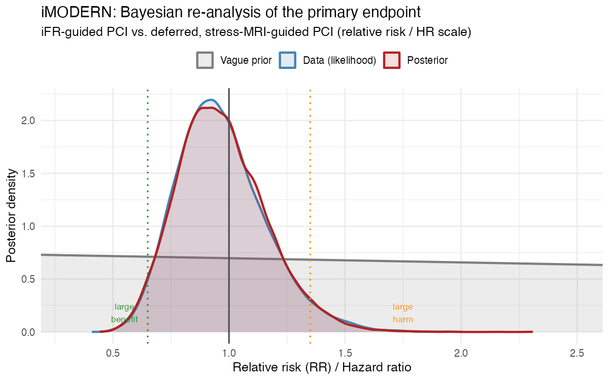

# Background

[Here](https://www.nejm.org/doi/full/10.1056/NEJMoa2512918) and [here](https://www.nejm.org/doi/full/10.1056/NEJMoa2515704) are two recent randomized trials published in the NEJM.

The first article from the the *iMODERN Investigators* had the following conclusion

::: callout-note
## Conclusion

“Among patients with STEMI who have undergone successful primary PCI, immediate iFR-guided PCI was not superior to deferred cardiac stress MRI–guided PCI of nonculprit coronary-artery lesions with respect to death from any cause, recurrent myocardial infarction, or hospitalization for heart failure at 3 years.”
:::

While the second article from the *CHIP-BCIS3 Investigators* had the following conclusion

::: callout-note
## Conclusion

“Among patients with severely impaired left ventricular function undergoing complex PCI, elective left ventricular unloading with a microaxial flow pump did not reduce the risk of major adverse clinical outcomes at a minimum of 12 months.”
:::


Both trial designs employed open designs although they have nevertheless been judged to be of high quality due to proper randomization and intention to treat analyses. Given these positive attributes, how can I posit that these conclusions are at best incomplete and at worst misleading.

## My interpretations

### iMODERN trial

```{r eval=FALSE}
## ============================================================
## Bayesian re-analysis of the iMODERN trial primary endpoint
## Primary-endpoint events: 50/538 (9.3%) iFR group vs. 55/562 (9.8%)
## deferred stress-MRI group; HR = 0.95 (95% CI 0.65-1.40), P = 0.81
##
## Approach: fixed-effect "meta-analysis of one study" in brms.
## Because we only have the published summary statistic (HR + CI),
## we reconstruct log(HR) and its standard error and let brms treat
## that single estimate as data with known sampling SE. With a vague
## prior on the intercept (= pooled log HR), the posterior for a
## single known-SE observation is available in closed form (it is
## just prior x likelihood), so this also gives us an exact analytic
## check on the MCMC output.
## ============================================================

library(brms)
library(bayesplot)
library(ggplot2)
library(posterior)

options(digits = 3)

## ---- 1. Reconstruct log(HR) and its SE from the published CI ----
HR    <- 0.95
CI_lo <- 0.65
CI_hi <- 1.40

logHR   <- log(HR)
log_lo  <- log(CI_lo)
log_hi  <- log(CI_hi)

# 95% CI  <->  point estimate +/- 1.96 * SE  (log scale)
SE_logHR <- (log_hi - log_lo) / (2 * 1.96)

cat(sprintf("log(HR) = %.3f\nSE(log HR) = %.3f\n", logHR, SE_logHR))

dat <- data.frame(y = logHR, se = SE_logHR)

## ---- 2. Fit the "single-study" fixed-effect model in brms ----
## y | se(se, sigma = FALSE) ~ 1  fixes the residual SD to the known
## sampling SE (the standard brms trick for aggregate-data
## meta-analysis; with one row it is just a normal likelihood for
## the reported estimate). A vague/near-flat prior on the intercept
## lets the data dominate, as intended.

vague_prior <- prior(normal(0, 2), class = "Intercept")  # sd = 2 on log-HR scale is effectively flat over any clinically conceivable HR

fit <- brm(
  y | se(se, sigma = FALSE) ~ 1,
  data    = dat,
  family  = gaussian(),
  prior   = vague_prior,
  chains  = 4, iter = 8000, warmup = 2000,
  seed    = 123,
  refresh = 0
)

print(summary(fit))

## ---- 3. Posterior draws for the pooled log(HR) -> RR ----
post <- as_draws_df(fit)
post$RR <- exp(post$b_Intercept)

p_benefit <- mean(post$RR < 0.65)   # large benefit
p_harm    <- mean(post$RR > 1.35)   # large harm
p_equiv   <- mean(post$RR >= 0.65 & post$RR <= 1.35)  # clinical equivalence

cat(sprintf(
  "\nPosterior probabilities (brms/MCMC):\n  P(RR < 0.65) = %.3f\n  P(RR > 1.35) = %.3f\n  P(equivalence, 0.65-1.35) = %.3f\n",
  p_benefit, p_harm, p_equiv
))

## ---- 4. Exact analytic cross-check (closed form, no MCMC noise) ----
tau <- 2
prec_post  <- 1/tau^2 + 1/SE_logHR^2
sigma_post <- sqrt(1/prec_post)
mu_post    <- sigma_post^2 * (logHR / SE_logHR^2)

p_benefit_analytic <- pnorm(log(0.65), mu_post, sigma_post)
p_harm_analytic    <- 1 - pnorm(log(1.35), mu_post, sigma_post)
p_equiv_analytic   <- 1 - p_benefit_analytic - p_harm_analytic

cat(sprintf(
  "\nAnalytic closed-form check:\n  P(RR < 0.65) = %.3f\n  P(RR > 1.35) = %.3f\n  P(equivalence, 0.65-1.35) = %.3f\n",
  p_benefit_analytic, p_harm_analytic, p_equiv_analytic
))

## ============================================================
## 5. Graphics: prior, data (likelihood), and posterior together
## ============================================================

## 5a. Draws for the prior only (sample_prior = "only" refits under
## the prior alone so we can plot it on the same scale)
fit_prior <- update(fit, sample_prior = "only", refresh = 0)
prior_draws <- as_draws_df(fit_prior)
prior_draws$RR <- exp(prior_draws$b_Intercept)

## 5b. "Likelihood" draws: simple Monte-Carlo sample from
## Normal(logHR, SE_logHR) representing the data alone
set.seed(1)
like_draws <- data.frame(RR = exp(rnorm(nrow(post), logHR, SE_logHR)))

## Combine into one long data frame for ggplot
plot_df <- rbind(
  data.frame(RR = prior_draws$RR, dist = "Vague prior"),
  data.frame(RR = like_draws$RR,  dist = "Data (likelihood)"),
  data.frame(RR = post$RR,        dist = "Posterior")
)
plot_df$dist <- factor(plot_df$dist,
                        levels = c("Vague prior", "Data (likelihood)", "Posterior"))

p1 <- ggplot(plot_df, aes(x = RR, colour = dist, fill = dist)) +
  geom_density(alpha = 0.15, linewidth = 1, trim = TRUE) +
  geom_vline(xintercept = c(0.65, 1, 1.35), linetype = c("dotted","solid","dotted"),
             colour = c("forestgreen","grey30","darkorange"), linewidth = 0.7) +
  coord_cartesian(xlim = c(0.3, 2.5)) +
  scale_colour_manual(values = c("grey50", "steelblue", "firebrick")) +
  scale_fill_manual(values = c("grey50", "steelblue", "firebrick")) +
  labs(
    title = "iMODERN: Bayesian re-analysis of the primary endpoint",
    subtitle = "iFR-guided PCI vs. deferred, stress-MRI-guided PCI (relative risk / HR scale)",
    x = "Relative risk (RR) / Hazard ratio", y = "Posterior density", colour = NULL, fill = NULL
  ) +
  annotate("text", x = 0.55, y = 0, vjust = -0.5, label = "large\nbenefit", size = 3, colour = "forestgreen") +
  annotate("text", x = 1.75, y = 0, vjust = -0.5, label = "large\nharm", size = 3, colour = "darkorange") +
  theme_minimal(base_size = 12) +
  theme(legend.position = "top")

print(p1)
ggsave("output/imodern_prior_data_posterior.png", p1, width = 8, height = 5, dpi = 150)

## 5c. bayesplot view of the posterior draws for the intercept (log HR)
## and derived RR, with the equivalence margins overlaid
mcmc_post_array <- as.array(fit)

p2 <- mcmc_areas(mcmc_post_array, pars = "b_Intercept", prob = 0.95) +
  labs(title = "Posterior density of pooled log(HR)",
       x = "log(Hazard ratio)") +
  geom_vline(xintercept = log(c(0.65, 1, 1.35)), linetype = "dashed", colour = "grey40")

print(p2)
ggsave("output/imodern_bayesplot_logHR.png", p2, width = 7, height = 4.5, dpi = 150)

## Histogram of RR draws with shaded decision zones (bayesplot + manual shading)
p3 <- mcmc_hist(data.frame(RR = post$RR), pars = "RR", binwidth = 0.02) +
  coord_cartesian(xlim = c(0.3, 2.5)) +
  geom_vline(xintercept = c(0.65, 1, 1.35), linetype = c("dotted","solid","dotted"),
             colour = c("forestgreen","grey30","darkorange")) +
  labs(title = "Posterior distribution of the relative risk (RR)",
       subtitle = sprintf("P(RR<0.65)=%.3f   P(RR>1.35)=%.3f   P(equivalence)=%.3f",
                           p_benefit, p_harm, p_equiv),
       x = "Relative risk (RR)")

print(p3)
ggsave("outputimodern_posterior_RR_hist.png", p3, width = 8, height = 5, dpi = 150)

## ============================================================
## 6. Summary table
## ============================================================
results <- data.frame(
  quantity = c("P(large benefit, RR<0.65)", "P(large harm, RR>1.35)", "P(equivalence, 0.65<=RR<=1.35)"),
  brms_MCMC = c(p_benefit, p_harm, p_equiv),
  analytic  = c(p_benefit_analytic, p_harm_analytic, p_equiv_analytic)
)

results <- gt::gt(results)

gt::gtsave(results, "output/table.png", vwidth = 900, vheight = 400)

```


The iMODERN trial was a superiority trial that compared immediate iFR-guided PCI of nonculprit lesions in patients with STEMI with a deferred, ischemia-guided strategy (control / reference group) that was based on cardiac stress MRI. The hazard ratio for the primary end point (a composite of death from any cause, recurrent myocardial infarction, or hospitalization for heart failure at 3 years) was 0.95 (95% confidence interval [CI], 0.65 to 1.40; P = 0.81), leading to the authors conclude that “iFR-guided PCI was not superior to deferred cardiac stress MRI–guided PCI.”
The trial was powered for a 35% reduction in the relative risk of a primary end-point event,  which implies that the authors considered a margin of 35% to indicate clinical equivalence. Incorporating vague priors, thereby allowing the observed data to dominate, a Bayesian  analysis shows that the probabilities of a large benefit (relative risk, <0.65), large harm (relative risk, >1.35), and clinical equivalence are 0.028, 0.036, and 0.936, respectively. 



Graphically this can be displayed as follows




This Bayesian view reveals a more nuanced interpretation; the superiority of iFR is highly unlikely, inferiority is marginally more likely, and clinical equivalence overwhelmingly dominates.      
However, immediate iFR-guided PCI had an increased procedural burden, an excess of 149 procedures, and potential harm with no definitive evidence of long-term benefit as compared with cardiac stress MRI–guided PCI.      

[*This result challenges the benign claim of nonsuperiority and supports a more critical interpretation that iFR-guided PCI of nonculprit  lesions may be an inferior strategy.*]{.red-text}

## CHIP-BCIS3 trial

The CHIP-BCIS3 trial randomly assigned 300 patients with severe left ventricular dysfunction and
extensive coronary artery disease to a strategy of elective unloading
with a microaxial flow pump or to standard care during planned complex PCI. The
primary outcome was a hierarchical composite that included death from any cause,
disabling stroke, spontaneous myocardial infarction, hospitalization for cardiovascular
causes, or periprocedural myocardial injury at a minimum of 12 months, as
analyzed according to a win ratio.     

Rather than the usual equal weighting of all components in a composite outcome, the win ratio, by ranking the component events of more clinical importance, aims to assign more weight to the more important outcomes. The win ratio quantifies the magnitude of treatment benefit by dividing the total number of treatment wins by the total number of control wins so that win ratios >1.0 indicate treatment benefit. 

CHIP-BCIS3 r esults showed a win ratio of 0.85 (95%confidence interval [CI], 0.63 to 1.15) for ventricular unloading as compared with standard care. Although the results were described as statistically inconclusive, a more clinically nuanced inference is possible. The trial was powered for a large benefit (win ratio of 1.6), equivalent to a difference of 3 to 4 percentage points in mortality or a difference of 5 to 7 percentage points in the hierarchical composite outcome (death from any cause, disabling stroke, spontaneous myocardial infarction, hospitalization for cardiovascular causes, or periprocedural myocardial injury). Accordingly, the observed win ratio does not merely fail to confirm benefit; it provides substantial evidence against the effect size motivating the trial. With respect to death from any cause (hazard ratio, 1.54; 95% CI, 0.99 to 2.41), a Bayesian reanalysis involving a vague prior centered on no absolute risk difference (SD = 3; 95% prior credible interval, −6 to 6 percentage points), which allows observed data to dominate, yields a posterior probability of improved survival of 0.16 with less than 0.02 probability of achieving the clinically meaningful differences sought at the design of the trial. Although statistical uncertainty remains regarding very small effects, the data argue strongly against a clinical benefit sufficient to justify adoption. Reporting posterior probabilities for meaningful thresholds would complement the win-ratio analyses and better align statistical and clinical inferences.

## Conclusion

Both trials share the same blind spot. A hazard ratio spanning unity or a win ratio straddling 1.0 is routinely read as "no effect," but that reading conflates genuine uncertainty with genuine equivalence, and neither iMODERN nor CHIP-BCIS3 supports doing so. iMODERN's "not superior" conclusion sat atop a posterior overwhelmingly favoring equivalence — yet equivalence plus 149 additional procedures is not a neutral result, it is an argument against adoption. CHIP-BCIS3's "statistically inconclusive" win ratio sat atop a posterior in which the benefit the trial was designed to detect was less than 2% likely, and any survival improvement at all only 16% likely. Neither reanalysis required unusual assumptions — a vague or weakly informative prior was enough to let the data speak. Reporting posterior probabilities against pre-specified, clinically meaningful thresholds alongside the conventional frequentist summary would help readers, and the committees who write guidelines from these trials, remember that "[absence of evidence is not evidence of absence](https://www.bmj.com/content/311/7003/485.long)" and distinguish "we can't be sure"  from "the evidence argues against it."
